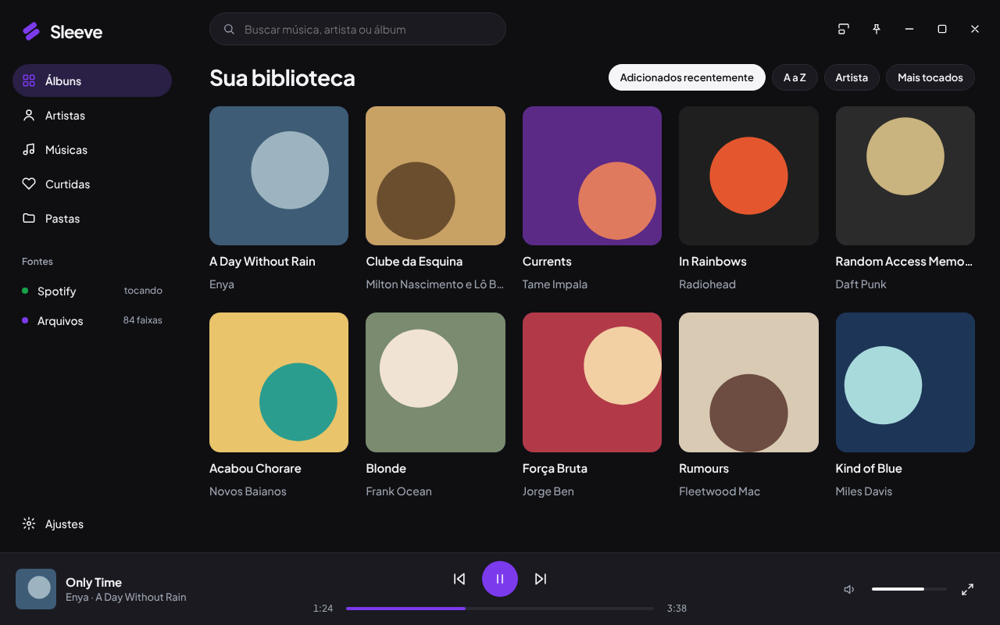
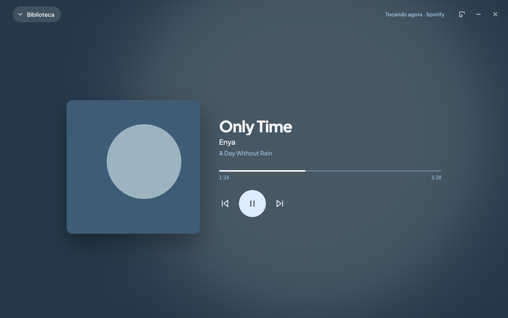
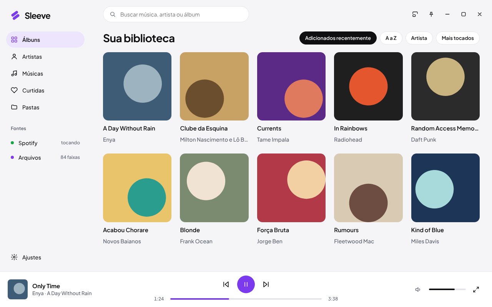

<p align="center">
  
</p>

<p align="center">Player de música com a capa do álbum em destaque, o resto em silêncio.</p>



O Sleeve toca os seus arquivos de música e mostra e controla o Spotify, num visual limpo: a capa grande, o fundo desfocado com as cores dela e nada sobrando. Roda no Windows hoje e foi feito para rodar também no [Alba OS](https://github.com/paulocmarinho/lumen-os).

## Recursos

- **Biblioteca** a partir das suas pastas: álbuns, artistas, músicas e curtidas, com busca e ordenação.
- **Toca arquivos** MP3, FLAC, M4A/AAC, OGG, Opus e WAV, com fila, aleatório e repetir.
- **Abre direto do Windows**: dois cliques num arquivo de música (ou *Abrir com › Sleeve*) tocam na hora, mesmo fora da biblioteca.
- **Capas** de dentro do arquivo, da pasta do álbum (`cover.jpg`, `folder.jpg`…) ou, se faltar, do iTunes em 1000 px (opcional).
- **Spotify junto**: mostra e controla o que toca no Spotify, sem login. Dar play num arquivo pausa o Spotify, e vice-versa.
- **Tocando agora** em tela cheia, com as cores tiradas da capa, e **mini player** que fica por cima das outras janelas.
- **Modo claro, escuro ou automático** (segue o sistema).
- **Bandeja do Windows**, volume só do Spotify na roda do mouse e opção de iniciar com o Windows.
- **Atualiza sozinho** pelas versões publicadas aqui no GitHub.

| Tocando agora | Modo claro |
|---|---|
|  |  |

## Baixar e usar (Windows)

Precisa do Windows 10 ou 11 com o **WebView2** (o motor do Microsoft Edge, que já vem no sistema atualizado).

Baixe o `Sleeve.exe` mais recente em [Releases](https://github.com/paulocmarinho/sleeve/releases/latest) e abra. Depois disso ele se atualiza sozinho: ao abrir, procura a versão nova aqui no GitHub, baixa em segundo plano e troca quando você reiniciar (dá para desligar em Ajustes).

Para gerar o `Sleeve.exe` você mesmo:

1. Instale o [.NET 8 SDK](https://dotnet.microsoft.com/download/dotnet/8.0).
2. Rode `build.bat` na pasta do projeto.
3. O app sai em `dist\Sleeve.exe`, um arquivo único e portátil.

Como o .exe não é assinado, o Windows pode avisar na primeira vez: clique em **Mais informações › Executar assim mesmo**.

Configurações ficam em `%AppData%\Sleeve`; a biblioteca lida e as capas, em `%LocalAppData%\Sleeve` (apagar essa pasta só faz o Sleeve ler tudo de novo).

### Atalhos

| Tecla | O que faz |
|---|---|
| Espaço | Tocar / pausar |
| ← / → | Faixa anterior / próxima |
| M | Mini player |
| T | Sempre no topo |
| Ctrl+F | Buscar |
| Esc | Fechar o tocando agora |

## Como é feito

```
src/
  web/        a interface: HTML, CSS e JavaScript sem etapa de build, igual em todos os sistemas
    app.js      telas, fila e player
    bridge.js   a ponte com o sistema (Windows hoje, Alba OS em seguida)
    demo.js     dados de exemplo para testar a interface num navegador comum
    fontes/     Plus Jakarta Sans (SIL Open Font License)
  windows/    o app do Windows em C#/WPF: mostra a interface num WebView2 e faz o que só o sistema sabe
    LibraryService.cs  lê as pastas de música (TagLib#) e monta álbuns e capas
    MediaService.cs    lê e controla o Spotify pelo controle de mídia do Windows
    VolumeService.cs   volume só do Spotify (NAudio)
    UpdateService.cs   atualização automática pelo GitHub Releases
.github/workflows/publicar.yml   gera o .exe e publica a versão quando o número muda
assets/
  marca/      logo, marca e ícones
  telas/      imagens deste README
```

A interface só conversa com o sistema por mensagens (`bridge.js` descreve todas). Para levar o Sleeve a outro sistema, basta escrever outra ponte.

Para mexer só no visual, sem compilar nada:

```
cd src/web
python -m http.server
```

e abra `http://localhost:8000/?spotify=tocando` (ou `?tema=dark`, `?tela=tocando`).

## Publicar uma versão nova

1. Mude o número em `<Version>` no `src/windows/Sleeve.csproj` (por exemplo, de `0.7.0` para `0.7.1`).
2. Envie para a branch `main`.
3. O GitHub Actions gera o `Sleeve.exe` e cria a versão em Releases (uns 5 minutos). Quem tem o Sleeve instalado recebe na próxima vez que abrir.

Mudanças sem trocar o número da versão ficam no código, mas não viram atualização.

## Identidade visual

Marca das duas pílulas em violeta **#7C3AED**, fundo **#F5F5F7** (claro) ou **#0F0F12** (escuro) e a fonte [Plus Jakarta Sans](https://github.com/tokotype/PlusJakartaSans). Os arquivos da marca estão em `assets/marca`.

## Licença

Código sob a licença [MIT](LICENSE). A fonte Plus Jakarta Sans é distribuída sob a [SIL Open Font License 1.1](src/web/fontes/OFL.txt).
